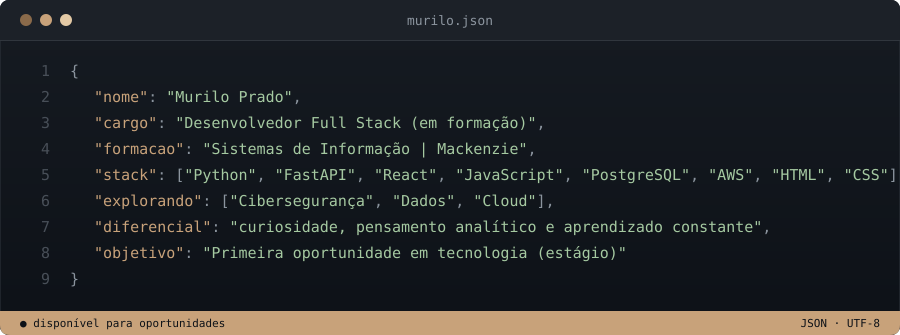

  
 

---

## 👨‍💻 Sobre mim

Olá! Sou estudante de **Sistemas de Informação no Mackenzie** e desenvolvedor em formação, interessado em tecnologia, desenvolvimento de software e resolução de problemas.

Atualmente, estou desenvolvendo minhas habilidades em programação e construindo projetos próprios para colocar em prática o que aprendo.

Tenho estudado principalmente:

- Desenvolvimento Back-End com Python e FastAPI.
- Desenvolvimento Front-End com JavaScript e React.
- Banco de dados e integração com APIs.
- Fundamentos de computação, lógica e estruturas de dados.

Também tenho interesse em áreas como Inteligência Artificial, Cibersegurança, Dados e Cloud Computing.

## 🛠️ Tecnologias e ferramentas

  

## 🗂️ Meu perfil

  

## 🚀 Projetos em destaque

### 🚗 ADAS
Projeto acadêmico voltado ao estudo e desenvolvimento de um sistema de assistência avançada ao motorista.

### 💰 Finlumis
Plataforma em desenvolvimento para organização financeira pessoal, acompanhamento patrimonial e investimentos em um só lugar.

### 💻 Portfólio
Meu espaço pessoal para apresentar projetos, compartilhar conhecimentos e acompanhar minha evolução como desenvolvedor.

## 📚 Atualmente estudando

- Python e desenvolvimento Back-End.
- React e desenvolvimento Front-End.
- Criação e integração de APIs REST com FastAPI.
- Banco de dados e SQL.
- Estruturas de dados e lógica de programação.
- Fundamentos de computação e algoritmos.

## 🐍 Minhas contribuições

  

## 📫 Entre em contato

  

  

  

